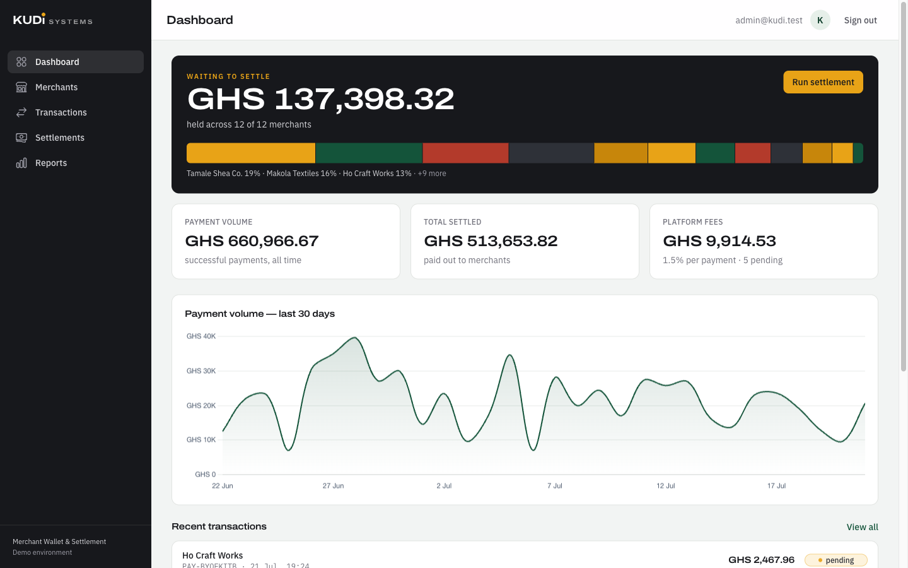
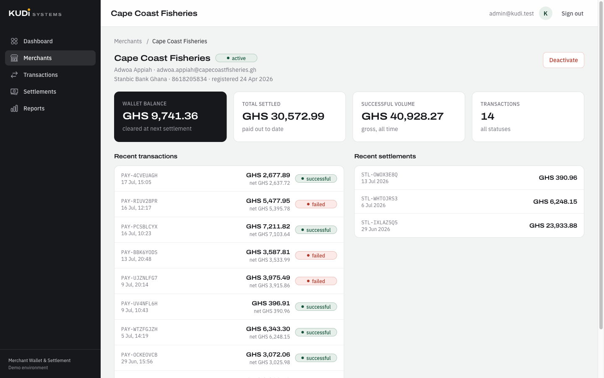
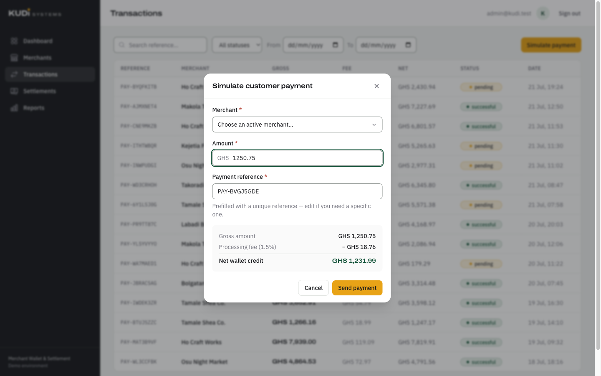
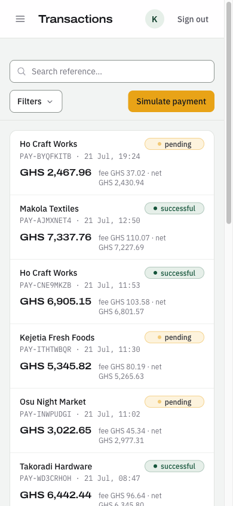

# Kudi — Merchant Wallet & Settlement Dashboard

A merchant wallet and settlement dashboard for a fintech platform: register merchants, simulate customer payments with a 1.5% processing fee, track wallet balances, and run daily settlements — built as a take-home assessment for Kudi Systems.

**Stack:** Vue 3 + TypeScript + Tailwind CSS v4 + Pinia (frontend) · Laravel 13 + SQLite + Sanctum (backend) · Pest + Vitest (tests) · Docker (one-command run)

## Running the application

### Option A — Docker (recommended for review)

```bash
docker compose up -d --build
```

Open **http://localhost:8080** and sign in with `admin@kudi.test` / `password`.
The first boot migrates and seeds ~30 days of realistic data automatically.

### Option B — Local (Laravel Herd / any PHP 8.3+, Node 20+)

```bash
# Backend
cd backend
composer install
cp .env.example .env && php artisan key:generate
touch database/database.sqlite
php artisan migrate --seed
php artisan serve            # http://localhost:8000

# Frontend (second terminal)
cd frontend
npm install
npm run dev                  # http://localhost:5173
```

Open **http://localhost:5173** — the Vite dev server proxies API calls to Laravel so session cookies stay first-party.

### Tests

```bash
cd backend && php artisan test    # 43 tests — business rules, API, auth
cd frontend && npm test           # 15 tests — money math, components, stores
cd frontend && npm run lint       # ESLint, incl. vue/no-undef-components
```

## Screens

| | |
|---|---|
|  |  |
| **Dashboard** — balances, volume, settlements, fees, 30-day chart | **Merchant detail** — wallet, stats, transactions and settlements |
|  |  |
| **Payment simulator** — live gross → 1.5% fee → net breakdown | **Mobile** — ledgers become cards, filters collapse behind a toggle |

## Design

The interface is built around the settlement cycle rather than around a grid of statistics: float accumulates in merchant wallets, a run sweeps it out, and the balance resets. That rhythm is the operator's whole job, so it leads.

- **The settlement band** is the one bold element. The float waiting to be settled is drawn as proportional strips, one per merchant, so you can see *whose* money is sitting there — composition a total can never show. Kente is woven as narrow strips of banded cloth sewn edge to edge, so the reference is structural and driven by the data, not a pattern applied on top. Everything around it is kept quiet.
- **Colour.** Kente maize (`#E8A317`) is the accent, because gold is the obvious colour for money in a Ghanaian payments product and because the alternative — Tailwind's default indigo — is what every dashboard reaches for. Deep forest green carries interactive text and settled states, clay carries failure, on a warm near-black and a paper with a faint green cast. Gold measures 2.2:1 on white, so it only ever appears as a fill behind dark text, never as text itself.
- **Type.** Archivo, used at an expanded width for money figures, against IBM Plex Sans for the interface and IBM Plex Mono for machine identifiers. The width contrast between the display and body faces is the identity, rather than a colour or an ornament.
- **Currency** displays as the ISO code (`GHS 1,250.75`) rather than the ₵ symbol: Archivo draws U+20B5 as a C with a stubby tick that reads as "GHC" at display sizes, and money is the entire content of this product.

## What's included

- **Dashboard** — total merchant balances, payment volume, settlement totals, platform fees, a 30-day volume chart, and recent transactions.
- **Merchants** — searchable/filterable list, registration with validation (bank *or mobile money* settlement institution), activate/deactivate with confirmation, and a detail page with wallet, stats, transactions, and settlements.
- **Payments** — a simulator that shows the gross → 1.5% fee → net breakdown live as you type, creates a `pending` transaction, then resolves it ~2s later via a simulated gateway callback (~90% success). Successful payments credit the merchant wallet with the net amount.
- **Settlements** — outstanding-balance banner, a manually triggered settlement run with a confirmation showing the exact amount to be moved, and batch history. Views update without a page reload.
- **Reports** — platform fees earned, successful volume, settlement totals, and a transaction-outcome breakdown, with date-range presets and custom ranges.
- **Auth** — session login via Laravel Sanctum's SPA cookie flow; all API routes are guarded.

## Design decisions

- **Money is integers, end to end.** All amounts are stored and transported as integer minor units (pesewas). Only the frontend's `utils/money.ts` formats for humans. The 1.5% fee is computed with pure integer math, rounded **half-up** (`fee = ⌊(gross × 150 + 5000) / 10000⌋`) — the conventional commercial rounding, mirrored exactly in backend (`App\Support\Money`) and frontend fee preview, and pinned by tests on both sides.
- **Settlement decrements, never zeroes.** The settlement run locks wallet rows (`lockForUpdate`) inside one DB transaction, writes a settlement record per merchant, and decrements each balance by the settled amount rather than setting it to zero — a concurrent credit can never be silently destroyed. Each run shares one `BATCH-…` reference.
- **The invariant is tested.** `wallet.balance = Σ(successful net) − Σ(settled)` is asserted in the test suite, and the seeder satisfies it by replaying 30 days of activity chronologically with real settlement runs at historical timestamps.
- **Pending payments never touch wallets.** They credit only when processed; a settlement run between creation and processing simply leaves them for the next batch.
- **Race-safe processing.** The gateway callback endpoint re-checks the transaction status under a row lock inside the transaction, so two concurrent callbacks cannot double-credit a wallet.
- **A banks/mobile-money reference table** replaces the brief's free-text "bank name": merchants register against a seeded list of Ghanaian banks and mobile money providers (MTN MoMo, Telecel Cash, AT Money), which eliminates typos and mirrors real settlement rails. (Deviation from the brief's literal field list, chosen deliberately.)
- **SPA + API, same-origin cookies.** The Vite dev server and the Docker nginx both proxy `/api`, `/login`, `/logout`, and `/sanctum` to Laravel, so the Sanctum session cookie is always first-party — no cross-origin cookie fragility.
- **State management** is Pinia stores per domain (auth, dashboard, merchants, transactions, settlements) over a typed API client with a single error-normalization path: 422s map to field errors, everything else to toast-able messages.

## Accessibility

Targeting WCAG 2.1 AA. Audited by hand across contrast, keyboard operability, forms, ARIA, landmarks, and SPA-specific concerns.

- **Contrast** — every text/background pair was measured, not eyeballed. Secondary text on light surfaces uses `slate-500` (4.76:1); the same role on the dark hero cards uses `slate-400` (6.7:1), because `slate-500` there would fall to 3.6:1 and fail. Disabled controls are exempt per SC 1.4.3.
- **Keyboard** — skip-to-content link, visible focus rings on every interactive element, focus trapped in dialogs and restored to the trigger on close. The mobile nav drawer is a real dialog: Escape closes it, focus moves in and returns.
- **Forms** — every control has a bound `<label>`; server validation maps to per-field messages tied via `aria-describedby` with `aria-invalid`, and errors announce through `role="alert"`.
- **Status messages** — route changes, result counts after filtering, and load failures all announce through live regions; SPA navigation and in-place table swaps are otherwise silent. The payment fee breakdown announces once, ~700ms after typing stops, rather than interrupting on every keystroke of the amount. Error toasts never auto-dismiss, and hovering or focusing a toast pauses its timer (SC 2.2.1).
- **Non-text content** — the volume chart carries a text summary naming the total and busiest day, because a `<canvas>` exposes nothing to assistive tech; every decorative icon is `aria-hidden`; status is never conveyed by colour alone (badges print the status word).
- **Motion** — `prefers-reduced-motion` disables animation and transitions globally.

Two findings worth calling out, because they are invisible in a static reading of the markup:

- `BaseModal` listens for keys on `window`, not on the dialog element. A submit button that disables itself while loading makes browsers reset focus to `<body>`, at which point an element-bound handler stops receiving events — silently disabling both Escape and the focus trap. There is a regression test for this.
- Form-control borders use a dedicated `--color-field` token at 3.4:1 rather than the decorative `--color-line` (1.23:1). SC 1.4.11 governs the boundary that identifies a control, and a near-white border on a near-white page fails it; card edges and dividers are decorative and correctly stay light.

Known gaps: no automated axe/Lighthouse run (the next step, ideally in CI), and the mobile drawer relies on `inert`, which needs a polyfill below Safari 15.5.

## Assumptions

- **One wallet per merchant** (single currency, GHS). The brief consistently says "the merchant wallet"; wallets sit in their own table so multi-currency would be an additive change.
- **Inactive merchants still settle.** Deactivation blocks *new payments* only — money already owed is still paid out. The UI says this at deactivation time.
- **Currency is Ghanaian cedi**, stored as pesewas, formatted with `Intl.NumberFormat('en-GH')`. The currency lives in one config value (backend) and one util (frontend).
- **Single operator role.** The dashboard is an internal admin tool; there is no per-merchant login or row-level authorization. In production, account numbers would be masked in list views and access audited.
- **The payment gateway is simulated** — a weighted lottery (~90% success) resolves pending transactions when the frontend triggers the "callback" endpoint ~2s after creation.

## API summary

All routes are JSON, under `auth:sanctum` unless noted.

| Method | Path | Purpose |
|---|---|---|
| POST | `/login`, `/logout` | Session auth (guest / auth) |
| GET | `/api/user` | Current user |
| GET | `/api/dashboard` | Totals, 30-day volume series, recent transactions |
| GET | `/api/institutions` | Banks + mobile money providers for registration |
| GET/POST | `/api/merchants` | List (search, status, pagination) / register |
| GET | `/api/merchants/{id}` | Profile, wallet, stats, recent transactions and settlements |
| PATCH | `/api/merchants/{id}/status` | Activate / deactivate |
| GET | `/api/transactions` | List (search, status, merchant, date range, pagination) |
| POST | `/api/payments` | Create pending payment (fee precomputed) |
| POST | `/api/transactions/{id}/process` | Simulated gateway callback: resolve pending |
| GET | `/api/settlements` | List (date range, pagination) |
| POST | `/api/settlements/run` | Settle all positive balances into one batch |
| GET | `/api/reports/summary` | Fees, volume, settled totals, outcome counts by period |

## Tools used

Built with AI-assisted development (Claude Code), per the brief's recommendation. All business rules, architecture decisions, and code were reviewed and are explainable by the author.

## Known limitations

- `php artisan serve` (single PHP worker) backs the Docker image — fine for review traffic, not production; a real deployment would use FPM behind nginx.
- No per-merchant authentication, audit log, idempotency keys, or webhooks — out of scope per the brief.
- The transaction-outcome bar on Reports is proportional but not a full time-series chart; volume trends live on the Dashboard.
